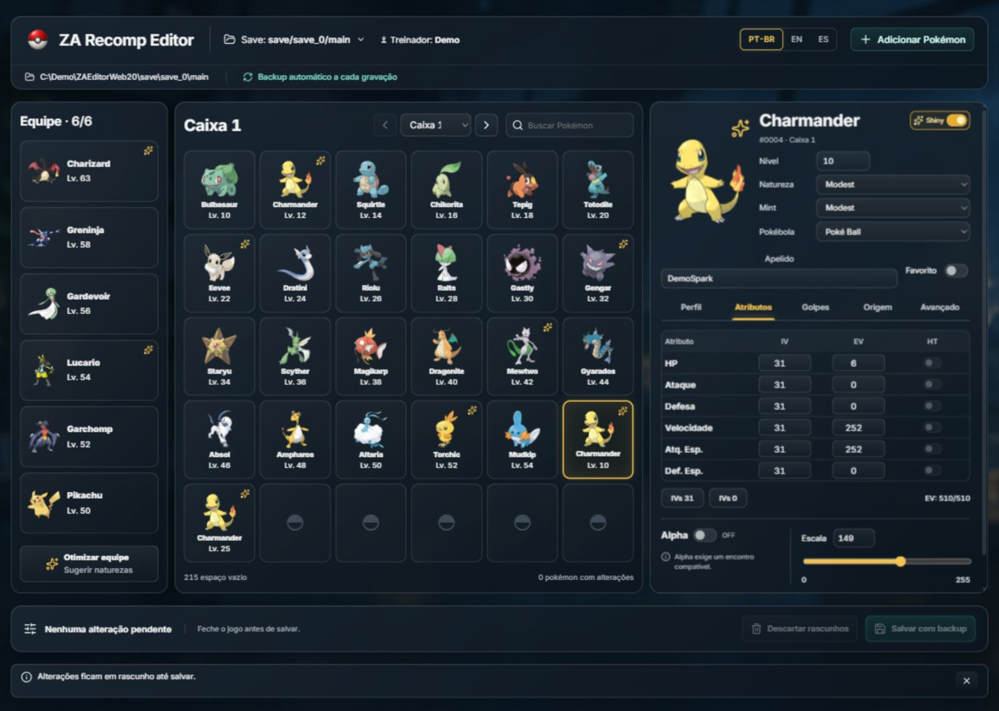
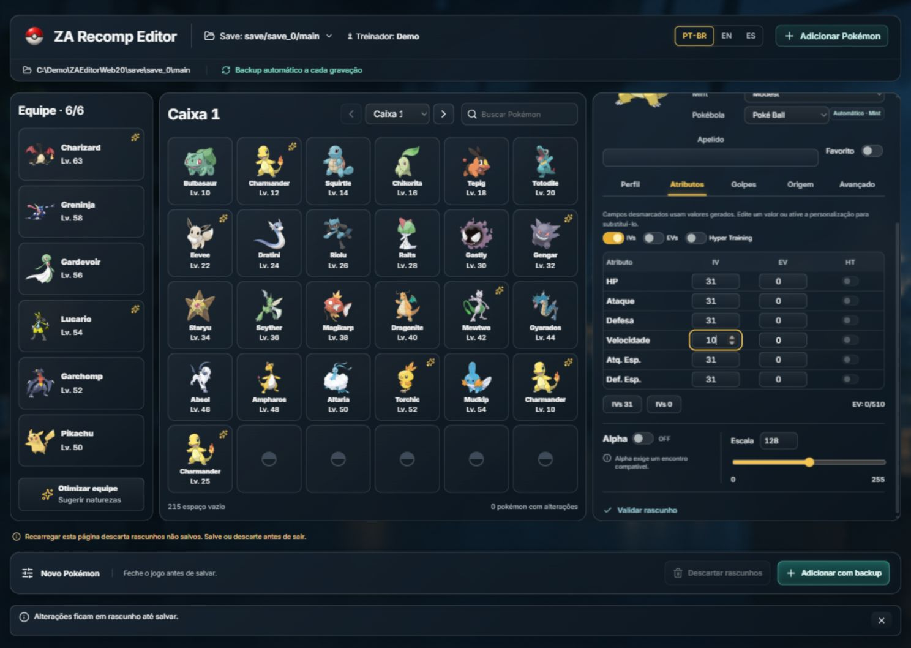

# ZA Recomp Editor — Español

**Editor portátil de partidas de Pokémon Legends: Z-A para ZA Recomp.** Equipo, cajas, creación y edición detallada en una única interfaz web local, oscura y acrílica, con copia de seguridad automática.

[Descargar para Windows](https://github.com/eep0x10/zarecomp-editor/releases/latest) · [English](README.md) · [Português](README.pt-BR.md) · [Guía detallada](docs/EDITING.md)

Windows x64. Extrae el ZIP en una carpeta con permiso de escritura y abre **RecompPokemon.exe**. El EXE abre el navegador en una dirección temporal `127.0.0.1`; no necesitas instalar Node.js, .NET ni un servidor. No incluye archivos del juego ni partidas personales.

La captura utiliza una partida sintética de demostración. Las propuestas de diseño están identificadas por separado y no son capturas funcionales.

Creación personalizada en el mismo panel

## Abrir y editar

Cierra ZA Recomp. Busca una partida o escribe la ruta absoluta de su archivo **main** en el selector integrado. Rutas habituales: `<ZA Recomp>/save/save_0/main` y `<ZA Recomp>/PORT/save/save_0/main`. Comprueba entrenador y fecha cuando haya varias copias.

Selecciona un Pokémon del equipo o de una caja; el editor aparece a la derecha. Cambiar de selección conserva los borradores. **Perfil, Atributos, Movimientos, Origen y Avanzado** permanecen en el mismo panel:

- Identidad, forma persistente, apodo, género, nivel, naturaleza original/menta, tipo variocolor, Poké Ball, objeto y favorito.
- IVs, EVs, Hyper Training, amistad y marcas; IV0–31, EV hasta252 por estadística y510 en total.
- Cuatro movimientos y registros Plus; PP e historial de reaprendizaje son de solo lectura.
- Entrenador original, identificadores, idioma y datos del encuentro/obediencia.
- Alfa, escala, título ya obtenido y datos técnicos/informe para consulta.

**Guardar con copia** valida y escribe los borradores del equipo y cajas en una transacción. **Descartar borradores** abandona los cambios pendientes mediante confirmación integrada. Guarda antes de recargar o cerrar la pestaña; los borradores no se escriben automáticamente.

Marcar **Alfa** fija Escala255 y completa al menos tres IVs31 sin reducir los demás IVs. El encuentro original debe ser compatible. Los tamaños predefinidos sincronizan los escalares nativos/HOME; los botones IV31/0 eliminan Hyper Training.

## Añadir Pokémon personalizado

**+ Añadir Pokémon** utiliza el mismo editor. Elige especie/forma, nivel, naturaleza, tipo variocolor y bola; activa las opciones que quieras personalizar. **Automático** conserva los valores generados, no significa cero o IVs perfectos.

El destino automático ocupa primero una plaza libre del equipo y después una caja desbloqueada. Nunca sobrescribe Pokémon existentes. Resuelve los borradores de edición antes de añadir. **Añadir con copia escribe inmediatamente**, separado del lote de borradores. Cancelar la creación no escribe nada.

La creación Alfa busca un encuentro compatible con especie/forma/nivel. Charmander necesita nivel25 o superior; Mewtwo no tiene plantilla Alfa en los datos incluidos. Una combinación imposible se rechaza antes de escribir.

## Optimize e idiomas

Optimize propone **solo naturalezas**, con motivos y revisión editable. No cambia IVs, EVs, movimientos ni niveles. El papel del equipo, la megaevolución y las mecánicas de Z-A afectan a la mejor elección.

Interfaz en PT-BR, inglés y español. Movimientos/naturalezas del catálogo e informes PKHeX permanecen en inglés. Se respeta movimiento reducido; el acrílico tiene alternativa opaca. En pantallas estrechas, el equipo se convierte en una franja y las cajas se expanden dentro de la misma página.

## Copias y privacidad

Cada escritura crea una copia completa de la carpeta del guardado en `ZA-Tool-Backups/<fecha>-<id>/`, con manifiesto SHA-256, validación y reemplazo atómico. Se muestra el recibo de la copia. Los IDs de operación evitan duplicar una adición reenviada. Un archivo modificado externamente o resultado incierto exige comprobar el estado, sin reintento automático.

Para restaurar: cierra juego/editor, conserva el archivo actual aparte y copia **main** desde la copia elegida. Cierra siempre el juego antes de guardar; no se detecta todo ejecutable renombrado. La validación no garantiza aceptación por el juego ni compatibilidad online.

El host escucha solo en el propio equipo y utiliza una credencial temporal. No se envían partidas, nombres de entrenador ni apodos. Preferencias/cache permanecen junto al EXE. Las imágenes opcionales usan IDs públicos de PokéAPI/GitHub; esos servicios reciben información HTTP normal. La edición funciona sin conexión, aunque pueden faltar imágenes no almacenadas. No compartas URLs de sesión ni diagnósticos privados.

La referencia interactiva de la API local está en `/api-docs`, con esquema `/openapi/v1.json`. Las escrituras aplican las mismas reglas del editor.

## Desarrollo y licencia

Para compilar: Windows, SDK .NET10 x64 y Node.js24/npm; ejecuta `./build.ps1`. Se genera `dist/RecompPokemon.exe` con los assets incorporados. Los usuarios del ZIP no necesitan estas herramientas. Consulta [pruebas y fuentes](README.md#build-from-source) y usa copias desechables.

Código GPL-3.0-or-later con fuentes correspondientes de PKHeX.Core. Consulta [avisos de terceros](THIRD_PARTY_NOTICES.md) y [licencias del frontend](WEB-THIRD-PARTY-NOTICES.txt). Los recursos y marcas Pokémon pertenecen a sus titulares. Proyecto independiente, sin afiliación a Nintendo, Game Freak, The Pokémon Company, ZA Recomp o PKHeX.
