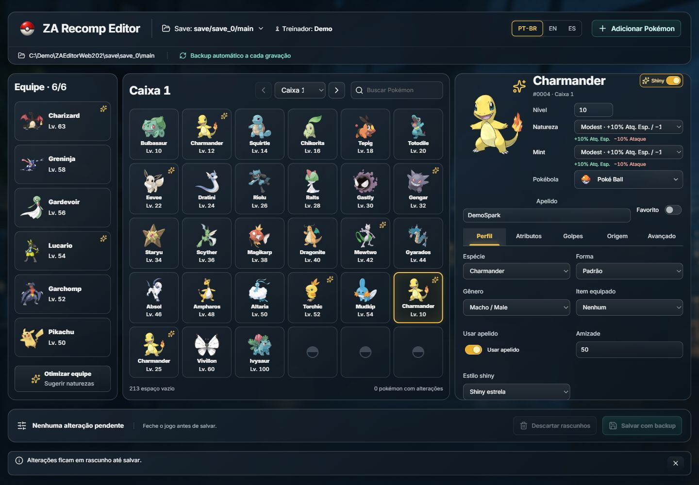
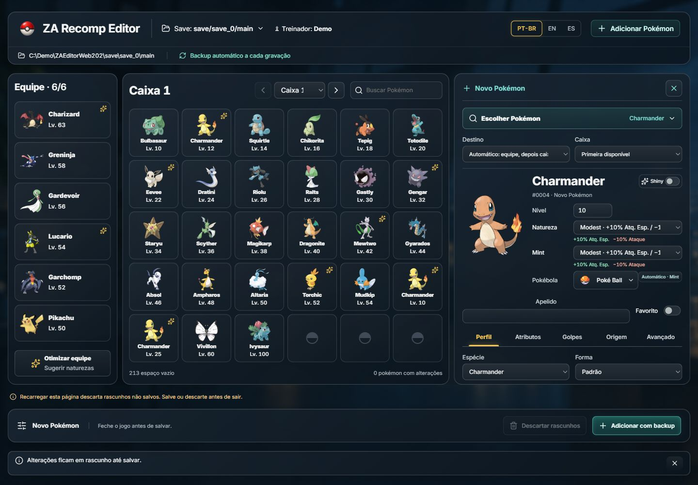
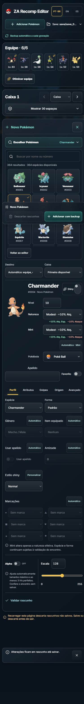
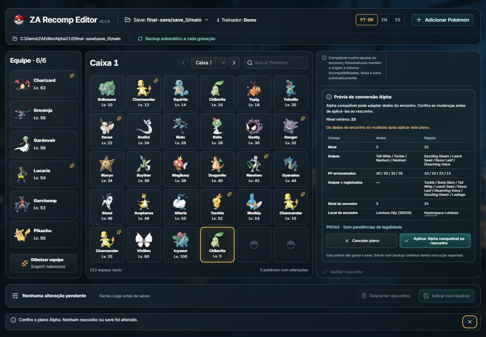
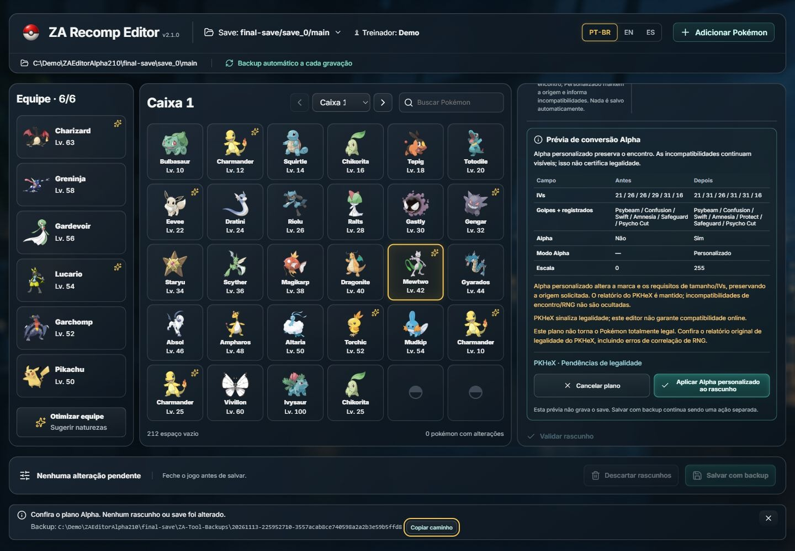
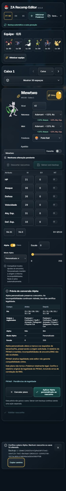
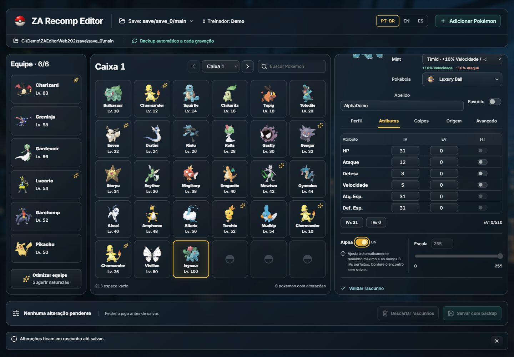
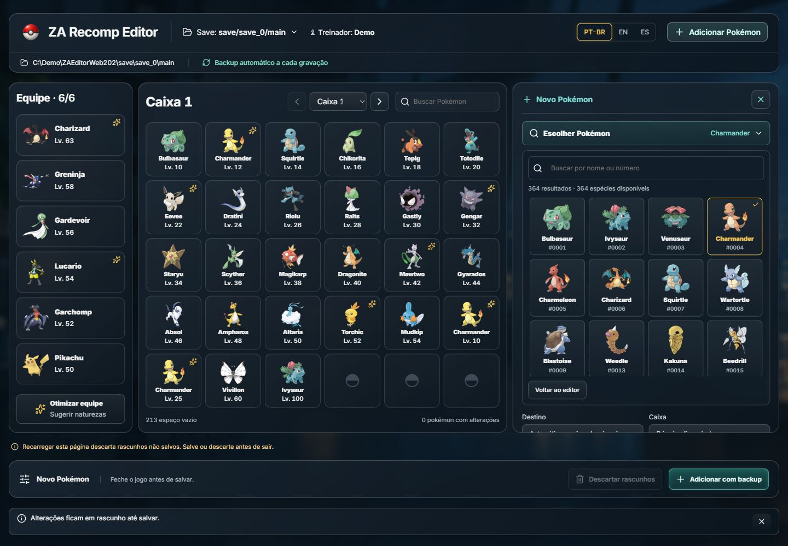

# ZA Recomp Editor

**A portable Pokémon Legends: Z-A save workbench for ZA Recomp — version 2.1.1.** Browse your party and boxes, edit detailed Pokémon data and create custom additions in one dark acrylic workspace. The Windows EXE opens a private local browser interface; its header shows the running host version.

**2.1.1 fix:** applying an Alpha plan now preserves the Pokémon identity and artwork in the inspector. Null API fields mean “keep the current value”; only actual planned changes are applied. [Fix evidence](docs/audits/2026-11-13-alpha-preview.md).

[Download for Windows](https://github.com/eep0x10/zarecomp-editor/releases/latest) · [Português (Brasil)](README.pt-BR.md) · [Español](README.es.md) · [Editing guide](docs/EDITING.md) · [Report an issue](https://github.com/eep0x10/zarecomp-editor/issues)

Windows x64. No installer, Node.js or separate .NET installation is required for the portable download. No game files or personal saves are included. Independent community tool, unaffiliated with Nintendo, Game Freak, The Pokémon Company, ZA Recomp or PKHeX.

## Start with your save

1. Extract the portable ZIP into a writable folder and close ZA Recomp.
2. Run **RecompPokemon.exe**. It opens your default browser at a temporary `127.0.0.1` address; the application stays on your computer.
3. Choose a discovered save or enter the full path to its **main** file in the inline save selector. Typical locations are `<ZA Recomp>/save/save_0/main` and `<ZA Recomp>/PORT/save/save_0/main`. Check the trainer and modification date when several copies exist.



General-workspace screenshots are real captures of build 2.0.3 using a synthetic demonstration save. The Alpha examples below show 2.1.0; older design proposals remain historical records.

<details>
<summary>Creation and the narrow-screen layout</summary>

Creation reuses the inspector and the primary action stays visible:



The same workspace reflows without horizontal page overflow:



</details>

## One workspace, complete editing

Your six-slot party stays on the left, a 30-slot box occupies the centre, and the selected Pokémon's inspector stays on the right. Search, switch boxes or select another Pokémon without opening a dialog. On narrow screens, the party becomes a strip and boxes expand inline above the editor.

| Field group | What you can edit or inspect |
| --- | --- |
| Profile | Species/persistent form, nickname, gender, level, original nature, Mint effect, shiny style, Poké Ball, held item and favourite |
| Attributes | Six IVs, six EVs and Hyper Training |
| Moves | Four current moves and registered Plus moves; stored PP/history are read-only |
| Origin | Original trainer, raw trainer IDs, language, encounter level/location/date and obedience |
| Advanced | Alpha, size scalars, an already-owned title, technical metadata and PKHeX report |

All edit controls update a **draft**, not the file. **Save with backup** validates and commits the pending party/box edits together. **Discard drafts** abandons pending edits; confirmation and recovery stay inline. Keep the workbench open while editing and save before reloading or closing the browser.

All 25 selectable capture balls have bundled PNG images available offline. Original and Mint nature controls show **+10% / −10%** stat effects or a neutral effect. A neutral Mint effect is available; when no Mint override exists, the effective nature follows the original nature. Size presets synchronize native Z-A/HOME scalars. The all-31/all-0 IV presets clear Hyper Training.

## Review an Alpha conversion

Alpha opens a plan before changing the draft. **Compatible** looks for an Alpha encounter and can propose a different encounter location/level, a higher current level and necessary move corrections. Every proposed change appears in the explicit before/after diff. **Custom** is an explicit alternative that preserves the requested origin while setting Alpha and its required size/IV dependencies. Custom can produce an invalid PKHeX report; the editor shows the actual findings.

Review the before/after values for origin, level, scalars, IVs, Hyper Training and Plus records, along with warnings and the PKHeX report. Applying the plan changes only the draft; **Save with backup** or **Add with backup** performs the write. Both modes require Scale 255 and at least three IVs of 31. Turning Alpha off clears its conversion mode; it does not undo other values already applied. A compatible Alpha encounter does not guarantee that the whole Pokémon is legal or accepted online.



<details>
<summary>Custom Alpha and narrow-screen review — version 2.1.0</summary>





</details>



## Add a custom Pokémon

**+ Add Pokémon** opens the species picker directly: all **364 species** in the current Engine catalog, in National Pokédex ID order, with images loaded as cards approach the visible area. Search by name or exact numeric ID (for example, `25` or `#25`). Use touch/click or keyboard arrows, Home/End and Enter; Escape returns to the editor. Missing artwork does not remove a species from the catalog.



Choosing a species opens its first supported form in the same inspector. **Choose Pokémon** reopens the picker. Changing species preserves your other creation details and resets moves and Plus records to **Automatic** for the new species. Choose level, nature, shiny style and ball, then customize optional details. **Automatic** preserves generated values; enable an optional override only when you want to supply it.

Choose **Automatic**, **Party** or **Boxes** as destination. Automatic fills an empty party slot first, then an empty slot in an unlocked box. Existing Pokémon are never overwritten. Resolve edit drafts before adding; **Add with backup writes immediately**, separately from the edit-draft batch. Cancel creation inline to leave the save unchanged.

The Alpha planner also supports creation. Compatible mode proposes an available encounter and any required level increase; for example, Charmander needs at least level 25. Mewtwo has no compatible Alpha template in the bundled data. Custom mode remains an explicit option with real incompatibility findings, never a fabricated legal result. **Automatic** shiny preserves generation; it is separate from choosing non-shiny, star or square.

## Optimize and languages

Optimize previews editable **nature suggestions**, with reasons based on stats and physical/special moves. It does not change IVs, EVs, moves or levels. There is no universally best competitive nature: team role, Mega Evolution and Z-A mechanics matter.

Interface languages: **PT-BR, English and Spanish**. Move/nature catalogue names and upstream PKHeX reports stay in English. Acrylic uses browser backdrop blur with opaque fallback; reduced-motion preferences are respected. Missing artwork does not prevent editing.

## Save protection and recovery

Each write uses the existing Engine: a full-folder backup in a sibling `ZA-Tool-Backups/<timestamp>-<id>/`, SHA-256 manifests, expected-file hash, validation/reopen and atomic replacement. The UI shows the backup receipt. Add requests use operation IDs to prevent the same delivery from adding twice. A stale file or uncertain write outcome requires reconciliation instead of automatic retries.

Always close the game first. Process checks cover known recomp executable names, not every renamed external writer. Field validation is not a guarantee of game/online acceptance. To restore manually, close the game/editor, preserve the current file separately, then copy **main** from the desired backup over the edited file.

## Local operation and privacy

The host binds only to `127.0.0.1`, uses a per-launch secret and exact local Origin/Host checks, and never uploads save bytes, trainer names or nicknames. Browser refresh can reconnect through an HttpOnly same-origin session cookie; no credential is stored in localStorage. The random port and secret change when the launcher restarts. Preferences and optional artwork cache stay beside the EXE. Do not share a runtime URL or private runtime diagnostics.

Optional Pokémon artwork is requested from PokéAPI/GitHub using public species/form/shiny identifiers. Those hosts receive ordinary HTTP connection information. The resolver keeps exact visible form and shiny identity: it tries artwork, HOME and standard PNG sources without substituting another form or normal colour for shiny. Successful images use the `cache/pokemon/v2` namespace; a recovered request updates all visible copies of that same image. Unavailable artwork is shown explicitly, with bounded retry. The core editor and bundled ball images work offline; uncached Pokémon artwork may be unavailable. Full image availability is not guaranteed. Closing the browser lets the host expire after an inactivity grace period; use its explicit exit control for an orderly stop.

A local **interactive OpenAPI reference** is available at `/api-docs`, with the schema at `/openapi/v1.json`. API writes enforce the same Engine rules as the interface. See [host verification and limits](WebHost/VERIFICATION.md).

## Build from source

Developer prerequisites: Windows x64, **.NET 10 SDK**, **Node.js 24 with npm**. These are build tools; users of the portable package do not need them.

```powershell
git clone https://github.com/eep0x10/zarecomp-editor.git
cd zarecomp-editor
./build.ps1
```

The script runs `npm ci`, builds the frontend into `WebHost/wwwroot`, embeds those assets and publishes a self-contained single EXE to `dist/`. `WebClient/` owns React/TypeScript/Anime.js; `WebHost/` owns the local API/lifecycle; `Engine/` owns save transactions. `App/` preserves the older WinForms source for reference. Corresponding source includes the pinned PKHeX vendor tree and npm lockfile.

Tests must use disposable copies of a Z-A save, never a personal save. The Engine harness writes fixtures under its `data/` directory; the host harness creates independent synthetic copies:

```powershell
dotnet run --project Tests/ZaTool.Tests.csproj -c Release -- --details "C:/DisposableTestSave/main"
dotnet run --project HostTests/HostTests.csproj -- "C:/DisposableTestSave/main"
dotnet run --project HostTests/HostTests.csproj -- --generated
dotnet run --project HostTests/HostTests.csproj -- --sprites
npm test --prefix WebClient
```

Local 2.1.0 verification passed **61 Alpha, 44 generated-save HTTP, 67 Engine and 39 client regression checks**. `--generated` runs Alpha checks before the HTTP suite and constructs an encrypted synthetic save without game assets or private input. `npm test --prefix WebClient` runs the client regressions. CI is configured for these client/generated-save checks after building; a local pass does not establish a published CI result. Sprite coverage remains the earlier **32 deterministic checks** with mock HTTP/generated PNGs and 24 sampled live retrieval checks; these were not rerun for this change. Optional `--sprites-live` depends on external availability. See the [2.1.0 audit](docs/audits/2026-11-13-alpha-review.md) and [harness guide](HostTests/README.md) for evidence and limits. Browser evidence is distinct from successful compilation.

## Licence and acknowledgements

Code: [GPL-3.0-or-later](LICENSE). [PKHeX.Core](https://github.com/kwsch/PKHeX), commit `96e33e7432d900e5345afdfd117eabfac43f5bbd`, is vendored with corresponding source. See [third-party notices](THIRD_PARTY_NOTICES.md) and [frontend runtime licences](WEB-THIRD-PARTY-NOTICES.txt) for React, Anime.js, Lucide, Inter, Pokémon resources and .NET. Pokémon assets and trademarks belong to their respective owners; the code licence does not grant rights to those assets.
