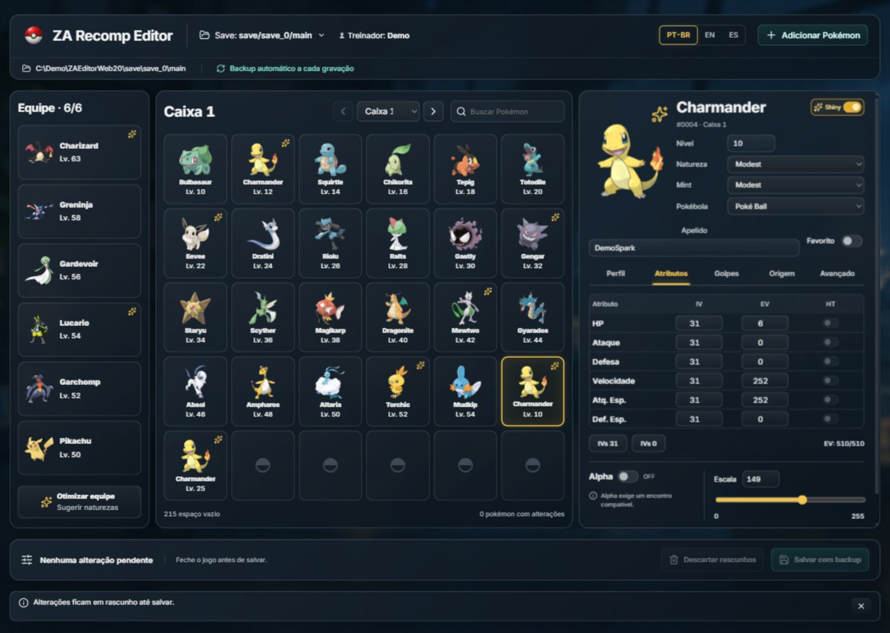
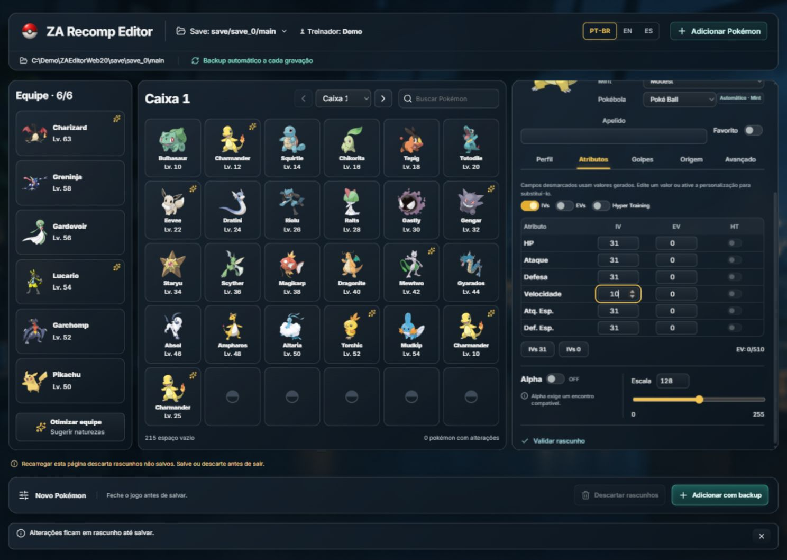
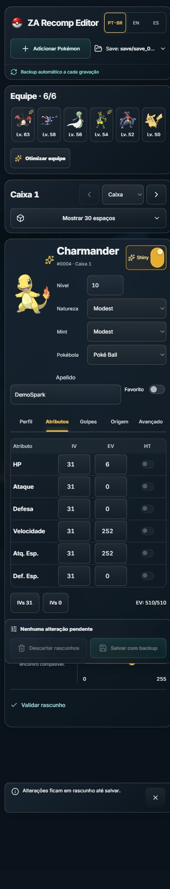

# ZA Recomp Editor

**A portable Pokémon Legends: Z-A save workbench for ZA Recomp.** Browse your party and boxes, edit detailed Pokémon data and create custom additions in one dark acrylic workspace. The Windows EXE opens a private local browser interface.

[Download for Windows](https://github.com/eep0x10/zarecomp-editor/releases/latest) · [Português (Brasil)](README.pt-BR.md) · [Español](README.es.md) · [Editing guide](docs/EDITING.md) · [Report an issue](https://github.com/eep0x10/zarecomp-editor/issues)

Windows x64. No installer, Node.js or separate .NET installation is required for the portable download. No game files or personal saves are included. Independent community tool, unaffiliated with Nintendo, Game Freak, The Pokémon Company, ZA Recomp or PKHeX.

## Start with your save

1. Extract the portable ZIP into a writable folder and close ZA Recomp.
2. Run **RecompPokemon.exe**. It opens your default browser at a temporary `127.0.0.1` address; the application stays on your computer.
3. Choose a discovered save or enter the full path to its **main** file in the inline save selector. Typical locations are `<ZA Recomp>/save/save_0/main` and `<ZA Recomp>/PORT/save/save_0/main`. Check the trainer and modification date when several copies exist.



Screenshots use a synthetic demonstration save. They are real application captures; the earlier design proposals are labelled separately in the design documentation.

<details>
<summary>Creation and the narrow-screen layout</summary>

Creation reuses the inspector and the primary action stays visible:



The same workspace reflows without horizontal page overflow:



</details>

## One workspace, complete editing

Your six-slot party stays on the left, a 30-slot box occupies the centre, and the selected Pokémon's inspector stays on the right. Search, switch boxes or select another Pokémon without opening a dialog. On narrow screens, the party becomes a strip and boxes expand inline above the editor.

| Field group | What you can edit or inspect |
| --- | --- |
| Profile | Species/persistent form, nickname, gender, level, original nature, Mint effect, shiny style, Poké Ball, held item and favourite |
| Attributes | Six IVs, six EVs, Hyper Training, friendship and coloured markings |
| Moves | Four current moves and registered Plus moves; stored PP/history are read-only |
| Origin | Original trainer, raw trainer IDs, language, encounter level/location/date and obedience |
| Advanced | Alpha, size scalars, an already-owned title, technical metadata and PKHeX report |

All edit controls update a **draft**, not the file. **Save with backup** validates and commits the pending party/box edits together. **Discard drafts** abandons pending edits; confirmation and recovery stay inline. Keep the workbench open while editing and save before reloading or closing the browser.

Size presets synchronize native Z-A/HOME scalars. The all-31/all-0 IV presets clear Hyper Training. Marking Alpha sets Scale 255 and raises enough IVs to reach at least three perfect stats without reducing the other IVs. Encounter constraints still apply; changing a flag does not replace an existing Pokémon's history.

## Add a custom Pokémon

**+ Add Pokémon** reuses the same inspector. Choose species/form, level, nature, shiny style and ball, then customize any optional details. **Automatic** preserves generated values; enable an optional override only when you want to supply it.

Choose **Automatic**, **Party** or **Boxes** as destination. Automatic fills an empty party slot first, then an empty slot in an unlocked box. Existing Pokémon are never overwritten. Resolve edit drafts before adding; **Add with backup writes immediately**, separately from the edit-draft batch. Cancel creation inline to leave the save unchanged.

Alpha creation chooses a compatible encounter for the species/form/level. Unsupported combinations are rejected before writing; for example, Charmander Alpha requires level 25 or higher, and Mewtwo has no Alpha template in the bundled encounter data.

## Optimize and languages

Optimize previews editable **nature suggestions**, with reasons based on stats and physical/special moves. It does not change IVs, EVs, moves or levels. There is no universally best competitive nature: team role, Mega Evolution and Z-A mechanics matter.

Interface languages: **PT-BR, English and Spanish**. Move/nature catalogue names and upstream PKHeX reports stay in English. Acrylic uses browser backdrop blur with opaque fallback; reduced-motion preferences are respected. Missing artwork does not prevent editing.

## Save protection and recovery

Each write uses the existing Engine: a full-folder backup in a sibling `ZA-Tool-Backups/<timestamp>-<id>/`, SHA-256 manifests, expected-file hash, validation/reopen and atomic replacement. The UI shows the backup receipt. Add requests use operation IDs to prevent the same delivery from adding twice. A stale file or uncertain write outcome requires reconciliation instead of automatic retries.

Always close the game first. Process checks cover known recomp executable names, not every renamed external writer. Field validation is not a guarantee of game/online acceptance. To restore manually, close the game/editor, preserve the current file separately, then copy **main** from the desired backup over the edited file.

## Local operation and privacy

The host binds only to `127.0.0.1`, uses a per-launch secret and exact local Origin/Host checks, and never uploads save bytes, trainer names or nicknames. Browser refresh can reconnect through an HttpOnly same-origin session cookie; no credential is stored in localStorage. The random port and secret change when the launcher restarts. Preferences and optional artwork cache stay beside the EXE. Do not share a runtime URL or private runtime diagnostics.

Optional artwork is requested from PokéAPI/GitHub using public species/form/shiny identifiers. Those hosts receive ordinary HTTP connection information. The core editor works offline once launched; uncached artwork may be unavailable. Closing the browser lets the host expire after an inactivity grace period; use its explicit exit control for an orderly stop.

A local **interactive OpenAPI reference** is available at `/api-docs`, with the schema at `/openapi/v1.json`. API writes enforce the same Engine rules as the interface. See [host verification and limits](WebHost/VERIFICATION.md).

## Build from source

Developer prerequisites: Windows x64, **.NET 10 SDK**, **Node.js 24 with npm**. These are build tools; users of the portable package do not need them.

```powershell
git clone https://github.com/eep0x10/zarecomp-editor.git
cd zarecomp-editor
./build.ps1
```

The script runs `npm ci`, builds the frontend into `WebHost/wwwroot`, embeds those assets and publishes a self-contained single EXE to `dist/`. `WebClient/` owns React/TypeScript/Anime.js; `WebHost/` owns the local API/lifecycle; `Engine/` owns save transactions. `App/` preserves the older WinForms source for reference. Corresponding source includes the pinned PKHeX vendor tree and npm lockfile.

Tests must use disposable copies of a Z-A save, never a personal save. The Engine harness writes fixtures under its `data/` directory; the host harness creates independent synthetic copies:

```powershell
dotnet run --project Tests/ZaTool.Tests.csproj -c Release -- --details "C:/DisposableTestSave/main"
dotnet run --project HostTests/HostTests.csproj -- "C:/DisposableTestSave/main"
dotnet run --project HostTests/HostTests.csproj -- --generated
```

The detailed Engine suite covers editing, creation, preservation and Alpha dependencies. Host tests cover the HTTP boundary and save receipts. `--generated` constructs an encrypted synthetic save in test code, without game assets or a private input. CI builds the frontend/host and runs those generated-save HTTP tests. Browser evidence and untested fault-injection cases are documented rather than inferred from successful compilation.

## Licence and acknowledgements

Code: [GPL-3.0-or-later](LICENSE). [PKHeX.Core](https://github.com/kwsch/PKHeX), commit `96e33e7432d900e5345afdfd117eabfac43f5bbd`, is vendored with corresponding source. See [third-party notices](THIRD_PARTY_NOTICES.md) and [frontend runtime licences](WEB-THIRD-PARTY-NOTICES.txt) for React, Anime.js, Lucide, Inter, Pokémon resources and .NET. Pokémon assets and trademarks belong to their respective owners; the code licence does not grant rights to those assets.
