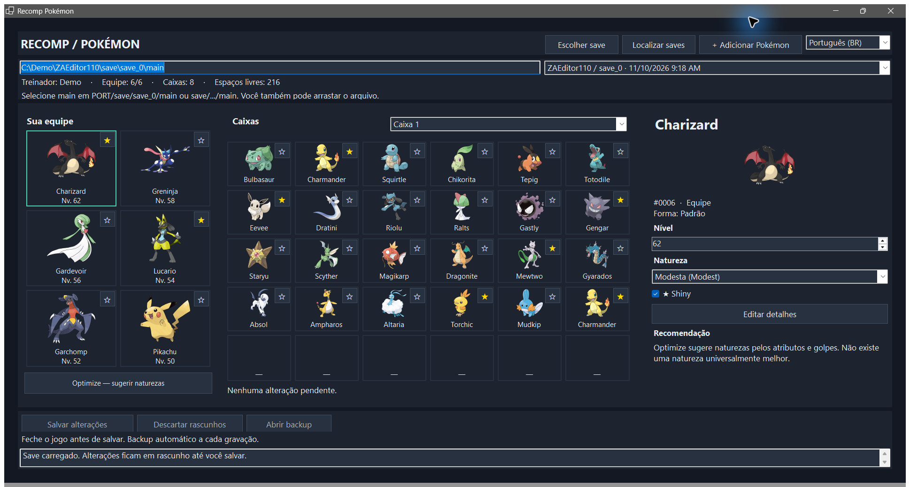
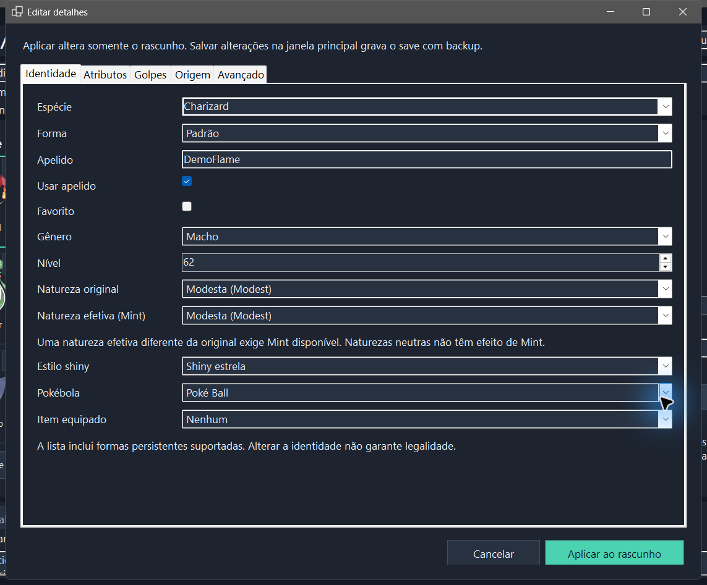
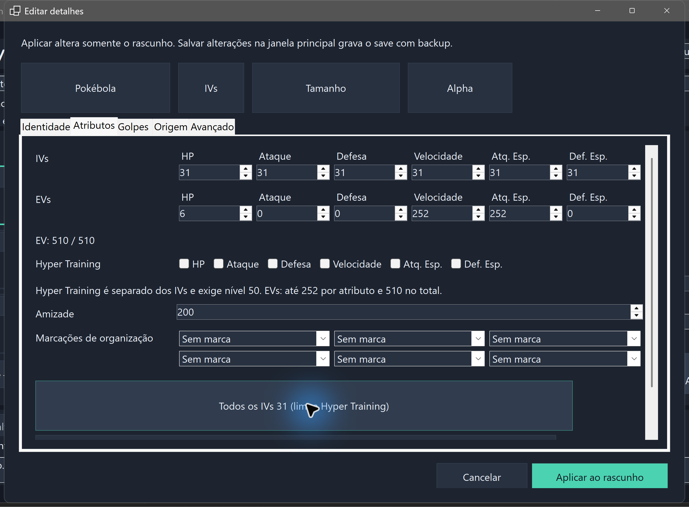
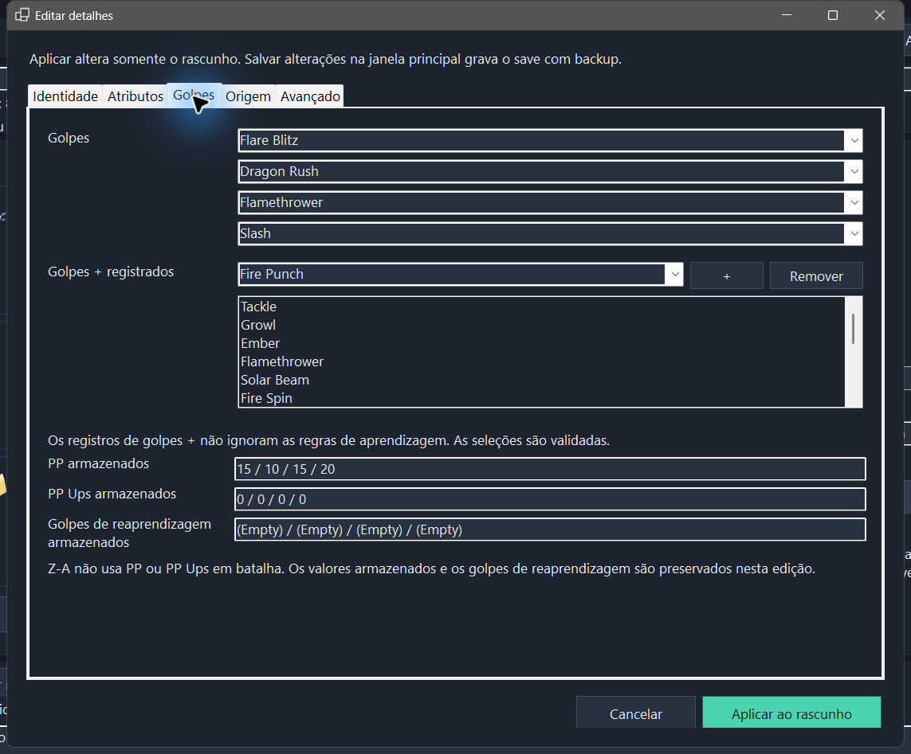
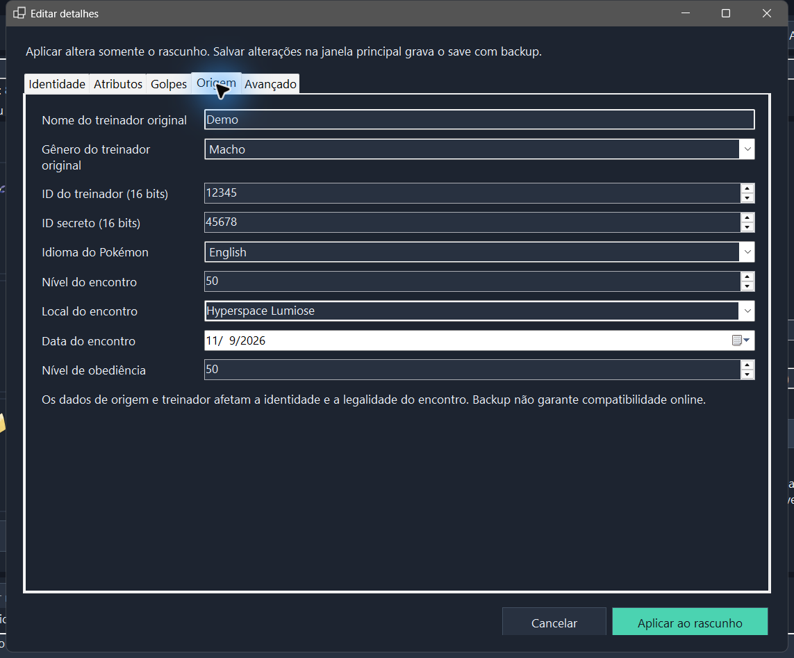
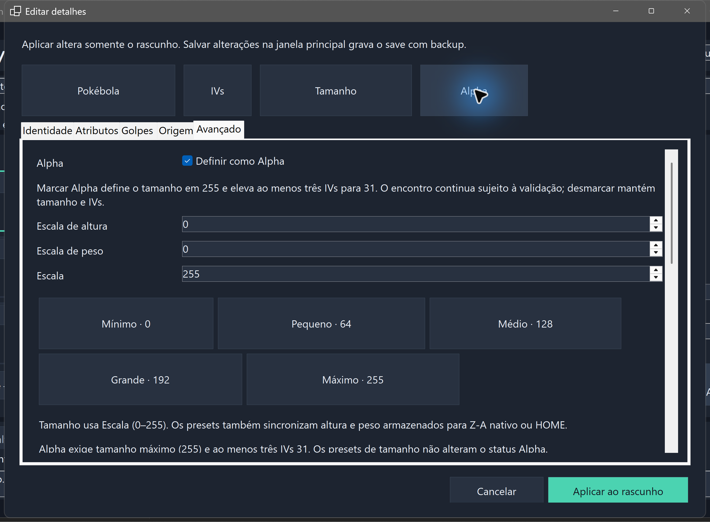
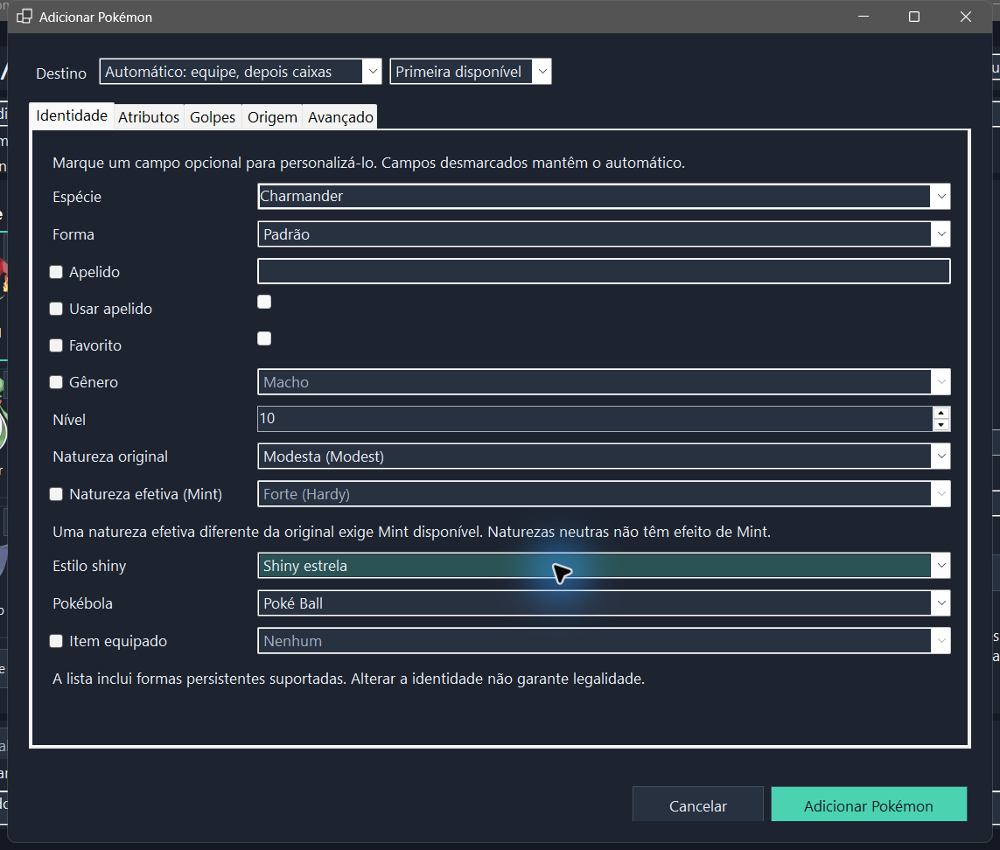
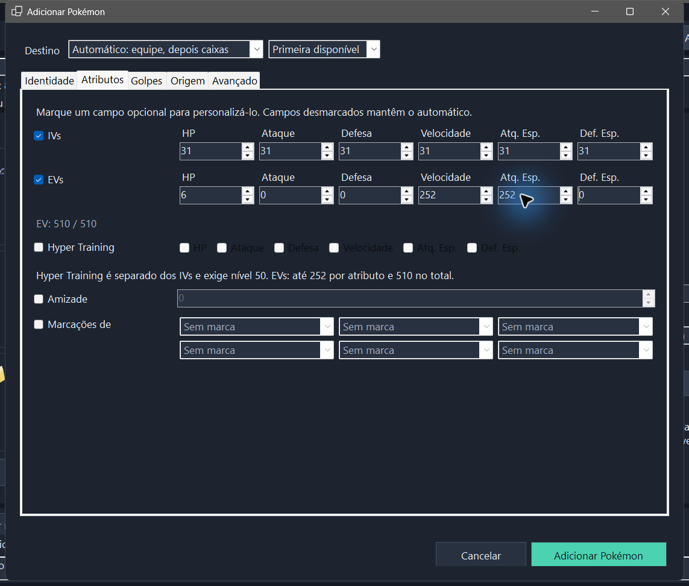
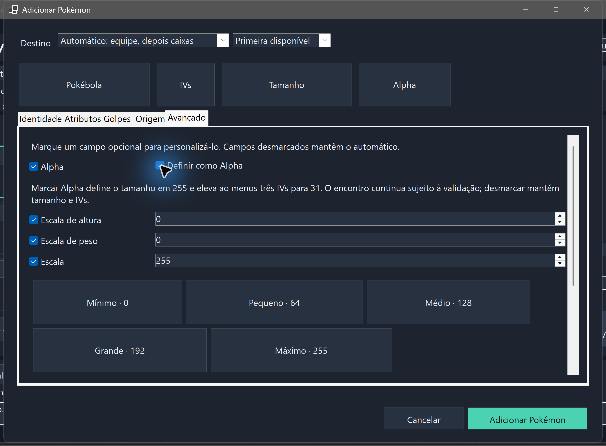

# ZA Recomp Editor — Português (Brasil)

**Editor portable de saves de Pokémon Legends: Z-A para o ZA Recomp.** Navegue pelas boxes, edite Pokémon existentes e adicione Pokémon personalizados com backup automático. O aplicativo se chama **Recomp Pokémon**.

[Baixar para Windows](https://github.com/eep0x10/zarecomp-editor/releases/latest) · [English — README principal](README.md) · [Español](README.es.md) · [Guia detalhado](docs/EDITING.md#português)

Windows x64, sem instalador nem instalação separada do .NET. Extraia o ZIP em uma pasta gravável ou pendrive. Preferências e cache ficam ao lado do executável. Não inclui arquivos do jogo nem saves pessoais.

## Comece pelo seu save

1. Baixe o ZIP portable em [Releases](https://github.com/eep0x10/zarecomp-editor/releases/latest) e extraia-o.
2. Feche o ZA Recomp e abra `RecompPokemon.exe`.
3. Use a busca ou selecione o arquivo **`main`**. Caminhos comuns: `<pasta do ZA Recomp>/save/save_0/main` ou `<pasta do ZA Recomp>/PORT/save/save_0/main`. Confira treinador e data se aparecerem várias cópias.

A equipe fica à esquerda, a box com 30 posições no centro e o Pokémon selecionado à direita.

As capturas mostram o aplicativo real usando um save sintético de demonstração.

## Edite um Pokémon existente

Os atalhos **Pokébola**, **IVs**, **Tamanho** e **Alpha** levam diretamente aos controles. Há presets de tamanho e botões para IVs 31 ou 0, que removem Hyper Training. Marcar **Definir como Alpha** ajusta a escala para 255 e completa pelo menos três IVs 31; os dados de encontro continuam sendo validados.

1. Selecione um Pokémon da equipe ou de uma box. Use os controles rápidos ou abra **Editar detalhes**.
2. Revise as cinco abas e clique em **Aplicar ao rascunho**. Isso **não** grava o save. **Cancelar** mantém o rascunho anterior intacto.
3. Revise os rascunhos e use **Salvar alterações** para validar e gravar o lote inteiro com backup. **Descartar rascunhos** abandona as mudanças pendentes.

| Aba | Conteúdo |
| --- | --- |
| Identidade | Espécie/forma, apelido, gênero, nível, natureza original e efeito de Mint, estilo shiny, bola, item e favorito |
| Atributos | IVs, EVs, Hyper Training, amizade e marcações coloridas |
| Golpes | Quatro posições e registros Plus; PP e histórico de relearn são somente leitura |
| Origem | Treinador original, IDs brutos, idioma, dados de encontro e obediência |
| Avançado | Alpha/tamanho, título já possuído, dados técnicos e relatório PKHeX original |

Veja as cinco abas de edição

**Identidade** — natureza original e efeito de Mint são escolhas separadas.

**Atributos** — IVs, EVs e Hyper Training separados, com total de EVs visível.

**Golpes** — escolha golpes compatíveis e confira os registros Plus.

**Origem** — confira os dados do treinador e do encontro antes de alterar.

**Avançado** — consulte dados técnicos preservados e opções de tamanho/título.

## Adicione um Pokémon personalizado

1. Salve ou descarte os rascunhos existentes e clique em **+ Adicionar Pokémon**.
2. Escolha espécie, forma, nível, natureza original, estilo shiny e bola. As mesmas cinco abas oferecem personalização: **marque um campo opcional para substituir seu valor automático**; deixe-o desmarcado para manter a geração automática.
3. Escolha o destino. **Automático** usa primeiro uma posição vazia da equipe e depois uma box desbloqueada. **Equipe** exige espaço; **Boxes** usa uma posição disponível sem substituir outro Pokémon.
4. Clique em **Adicionar Pokémon**. Essa ação **grava imediatamente com backup**; não cria um rascunho na janela principal. Cancelar o diálogo não grava nada.

Veja os atributos opcionais da adição

Ative apenas os IVs, EVs, Hyper Training e demais opções que quiser definir. Campo desmarcado não substitui o valor automático; os controles desativados não mostram uma prévia dos valores gerados.

O seletor de idioma alterna entre PT-BR, inglês e espanhol sem perder rascunhos. Catálogo e relatórios PKHeX permanecem em inglês. O tema escuro solicita Desktop Acrylic ao Windows compatível, com superfícies opacas como alternativa; a edição independe do efeito.

Consulte o [guia detalhado](docs/EDITING.md#português) para limites de campos e diferenças entre editar e adicionar. Não há editor hexadecimal, criação de ovos nem conversão de outros jogos.

## Criar um Alpha

Em **Adicionar Pokémon**, use **Alpha**, marque a personalização **Alpha** e depois **Definir como Alpha**. Escolha espécie e nível com encontro compatível (Charmander: nível 25 ou maior).

## Optimize

O botão sugere naturezas para a equipe e mostra o motivo antes de gravar. A recomendação usa os golpes físicos/especiais e atributos-base do Pokémon; perfis de suporte consideram as defesas. Não altera IVs, EVs, golpes ou nível. É um ponto de partida ajustável, não uma simulação de partidas nem uma classificação universal do metagame. Função da equipe, Mega Evolução, oponentes e tempos de recarga de Z-A podem mudar a melhor escolha.

O arquivo geralmente está em `<pasta do ZA Recomp>/save/save_0/main`; em alguns pacotes, a pasta do programa se chama `PORT`. O botão de busca procura locais comuns. Se houver várias cópias, confira a data e o treinador. A ferramenta não converte saves de outros jogos para Z-A.

## Proteção dos dados

Antes de gravar, a ferramenta cria uma cópia integral da pasta do save em uma pasta irmã `ZA-Tool-Backups/<data>-<id>/`, com manifesto SHA-256. Reabre o resultado, confere atributos e Pokémon anteriores e só então substitui o arquivo selecionado. Adicionar não substitui posições ocupadas; editar altera os Pokémon selecionados. Recusa save alterado desde a seleção, formato incompatível e espaço indisponível. Feche sempre o jogo: a detecção de processos conhecidos não reconhece todo executável renomeado.

Para restaurar, feche o jogo e a ferramenta e copie o `main` do backup desejado para o lugar do arquivo editado. Guarde os backups fora de pastas sincronizadas ou temporárias se quiser conservar uma cópia duradoura.

## Compatibilidade

A lista inclui espécies e formas persistentes presentes nas tabelas de Z-A da versão incorporada do PKHeX.Core. Por política do editor, são oferecidas formas persistentes, sem gravar formas temporárias de batalha nas boxes. O programa valida a estrutura do save; isso não garante que todo Pokémon personalizado corresponda a um encontro possível no jogo. A análise do PKHeX aparece no resultado. Alterar nível ou natureza recalcula os atributos, preservando status e HP anterior limitado ao novo máximo; alterar apenas shiny preserva esses valores.

As imagens são obtidas de recursos públicos da PokéAPI e ficam em cache junto ao aplicativo. A edição funciona sem internet; sem imagem disponível, o programa mantém nome e forma visíveis. Somente IDs públicos de espécies/formas são usados nas consultas: os arquivos de save, nomes de treinador e apelidos não são enviados.

Este aplicativo edita apenas Z-A. Não modifica o executável do recomp e não inclui arquivos do jogo. Não é afiliado à Nintendo, Game Freak, The Pokémon Company ou ao projeto PKHeX.

## Código e licença

Distribuído sob GPL-3.0-or-later, com código correspondente no pacote de fontes. Usa PKHeX.Core de [kwsch/PKHeX](https://github.com/kwsch/PKHeX), commit `96e33e7432d900e5345afdfd117eabfac43f5bbd`. Consulte `LICENSE` e os avisos de terceiros. O runtime .NET tem sua própria licença e avisos distribuídos junto ao aplicativo. Classes dos golpes vêm do [CSV público da PokéAPI](https://github.com/PokeAPI/pokeapi/blob/master/data/v2/csv/moves.csv), snapshot SHA-256 `8aafd37bf78f19471495c05b201545180f50f0a08a2a2a844d69f9837dd39ac9`. Os dados e imagens Pokémon mantêm os direitos de seus titulares; não são cobertos pela licença do código deste aplicativo.

Os nomes do catálogo e relatórios PKHeX permanecem em inglês. Preferências e cache precisam de uma pasta gravável para persistir; os hosts de imagens recebem os dados normais de conexão HTTP.

Para compilar as fontes: instale o SDK .NET 10 x64 e execute `./build.ps1`; saída em `dist/`. Veja comandos de testes no [README principal](README.md#build-from-source). Use somente cópias descartáveis e não publique saves em issues. Consulte os [avisos de terceiros](THIRD_PARTY_NOTICES.md).
