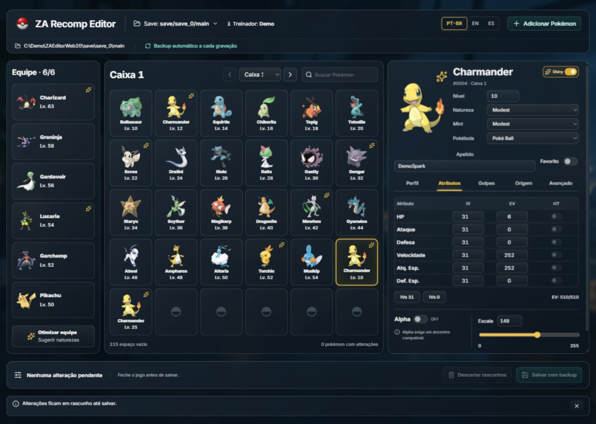
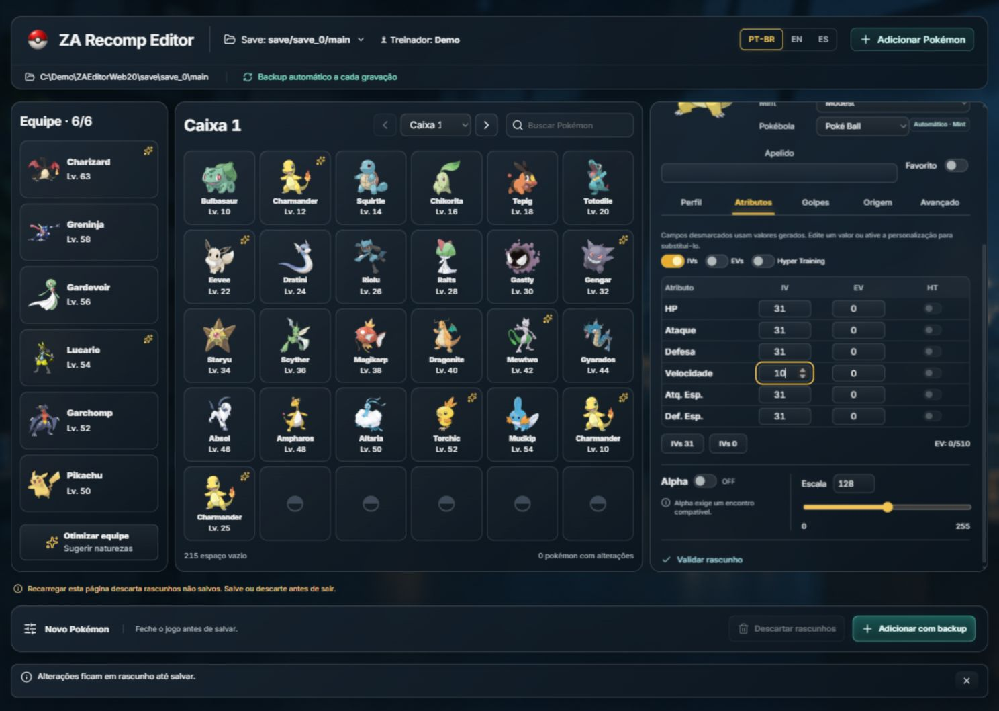
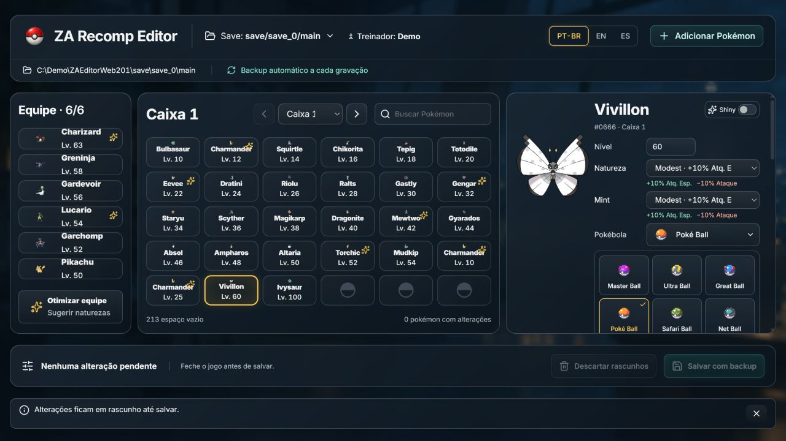

# ZA Recomp Editor — Português (Brasil)

**Editor portátil de saves de Pokémon Legends: Z-A para o ZA Recomp.** Equipe, boxes, criação e edição detalhada em uma única bancada web, com tema escuro, acrílico e backup automático.

[Baixar para Windows](https://github.com/eep0x10/zarecomp-editor/releases/latest) · [English](README.md) · [Español](README.es.md) · [Guia detalhado](docs/EDITING.md)

Windows x64. Extraia o ZIP em uma pasta gravável e abra **RecompPokemon.exe**. O EXE abre o navegador em um endereço local temporário `127.0.0.1`; você não precisa instalar Node.js, .NET ou um servidor. Não inclui jogo nem saves pessoais.

A captura usa um save sintético de demonstração. As propostas visuais anteriores estão identificadas como conceitos, separadas das capturas reais.

Veja como adicionar com detalhes

## Abrir seu save

Feche o ZA Recomp. No seletor de save, use a busca ou informe o caminho completo do arquivo **main**. Locais comuns: `<pasta do ZA Recomp>/save/save_0/main` ou `<pasta do ZA Recomp>/PORT/save/save_0/main`. Confira treinador e data se houver várias cópias. A seleção e os avisos ficam na própria página, sem abrir diálogos.

## Editar equipe e boxes

A equipe fica à esquerda, a box com 30 posições no centro e o editor à direita. Selecione um Pokémon e altere os campos; trocar a seleção mantém os rascunhos. As seções **Perfil, Atributos, Golpes, Origem e Avançado** ficam no mesmo painel.

- **Perfil:** espécie/forma persistente, apelido, gênero, nível, natureza original/Mint, estilo shiny, Pokébola, item e favorito.
- **Escolhas visuais:** as 25 Pokébolas têm imagens locais; cada natureza mostra o atributo que aumenta e diminui, ou indica efeito neutro.
- **Atributos:** IVs, EVs, Hyper Training, amizade e marcações. IVs 0–31; EVs até 252 por atributo e 510 no total.
- **Golpes:** quatro posições e registros Plus; PP e histórico são somente leitura.
- **Origem:** treinador, IDs brutos, idioma, local/nível/data de encontro e obediência.
- **Avançado:** Alpha, tamanho, título já possuído e dados técnicos/relatório para consulta.

**Salvar com backup** valida e grava os rascunhos da equipe e das boxes em uma operação. **Descartar rascunhos** abandona as alterações pendentes, com confirmação inline. Salve antes de atualizar ou fechar a aba: rascunhos não são arquivos gravados automaticamente.

Marcar **Alpha** ajusta Escala para 255 e completa pelo menos três IVs 31, preservando os demais IVs. O encontro original precisa ser compatível. Presets de tamanho sincronizam os escalares nativos/HOME; os botões de IVs 31/0 removem Hyper Training.

## Adicionar Pokémon personalizado

**+ Adicionar Pokémon** abre uma grade com todas as espécies do catálogo de Z-A, imagens e busca por nome ou número. **Escolher Pokémon** permite trocar a seleção. A criação reutiliza o painel de edição. Escolha espécie/forma, nível, natureza, shiny e Pokébola; ative os campos opcionais que quiser personalizar. Campo **Automático** mantém a geração do motor, não significa zero ou IV perfeito.

Destino **Automático** usa primeiro uma vaga na equipe e depois uma box desbloqueada. Equipe exige vaga; Boxes usa uma posição livre sem substituir outro Pokémon. Resolva os rascunhos de edição antes de adicionar. **Adicionar com backup grava imediatamente**, em uma operação separada do lote de rascunhos. Cancelar a criação não grava nada.

A criação Alpha procura um encontro compatível com espécie/forma/nível. Charmander Alpha exige nível 25 ou maior; Mewtwo não tem template Alpha nos dados incorporados. Combinações indisponíveis são recusadas antes da gravação.

## Optimize e idiomas

Optimize sugere **somente naturezas**, com motivo e revisão em rascunho. Não muda IVs, EVs, golpes ou nível. Não há uma natureza competitiva universalmente melhor; função da equipe, Mega Evolução e mecânicas de Z-A influenciam a escolha.

Interface em **PT-BR, inglês e espanhol**. Nomes de golpes/natures e relatórios PKHeX permanecem em inglês. O acrílico tem alternativa opaca; a interface respeita movimento reduzido. Em telas estreitas, a equipe vira faixa e as boxes se expandem dentro da mesma página.

## Backups e privacidade

Cada gravação cria uma cópia integral da pasta do save em `ZA-Tool-Backups/<data>-<id>/`, com manifesto SHA-256, validação, conferência de hash e substituição atômica. O recibo mostra a pasta do backup. Adições usam IDs de operação para evitar duplicação por reenvio. Save alterado externamente ou resultado de gravação incerto exige conferência, sem retentativa automática.

Para restaurar: feche jogo e editor, preserve o arquivo atual separadamente e copie o **main** do backup desejado para o lugar do editado. Feche sempre o jogo antes de salvar; a detecção não reconhece todo executável renomeado. Validação de campos não garante aceitação no jogo ou online.

O servidor escuta apenas no próprio computador e usa uma credencial temporária por execução. Saves, treinador e apelidos não são enviados. Preferências/cache ficam junto ao EXE. Imagens opcionais usam PokéAPI/GitHub com IDs públicos; esses hosts recebem os dados normais da conexão HTTP. Sem internet, a edição continua, mas imagens não armazenadas podem faltar. Não compartilhe URLs de sessão ou diagnósticos privados de execução.

A referência interativa da API local fica em `/api-docs`, e o esquema em `/openapi/v1.json`. São ferramentas de desenvolvimento; as gravações seguem as mesmas regras do editor.

## Código e licença

Para compilar: Windows, SDK .NET 10 x64 e Node.js 24/npm; execute `./build.ps1`. O script compila a interface, incorpora os assets e gera `dist/RecompPokemon.exe`. Esses requisitos são apenas para desenvolvimento. Consulte os [comandos de testes](README.md#build-from-source), usando cópias descartáveis de saves.

Código GPL-3.0-or-later e PKHeX.Core com fontes correspondentes. Consulte [avisos de terceiros](THIRD_PARTY_NOTICES.md) e [licenças do frontend](WEB-THIRD-PARTY-NOTICES.txt). Assets e marcas Pokémon pertencem aos titulares. Projeto independente, sem afiliação à Nintendo, Game Freak, The Pokémon Company, ZA Recomp ou PKHeX.
