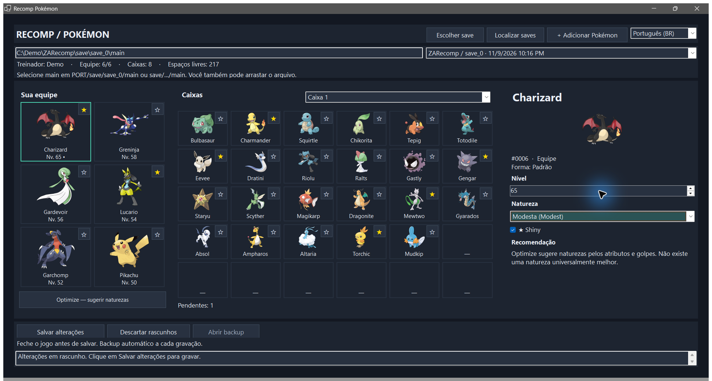

# Recomp Pokémon

[Baixar para Windows](https://github.com/eep0x10/zarecomp-editor/releases/latest) · [English](README.md) · [Español](README.es.md)

## Conheça a interface

Capturas reais do programa usando um save sintético de demonstração.

### Navegue pelas boxes

A equipe fica à esquerda, a box aberta no centro e o preview do Pokémon selecionado à direita.

### Edite sua equipe

Clique em um membro para editar nível, natureza e shiny. As mudanças ficam em rascunho até você salvar.

### Adicione um Pokémon

Clique em **+**, escolha espécie, forma, nível, natureza e shiny, e defina o destino automático, equipe ou box. As outras abas oferecem detalhes opcionais.

Ferramenta desktop **portable** para adicionar e editar Pokémon em saves de **Pokémon Legends: Z-A no ZA Recomp**. Interface em português, inglês e espanhol, sem instalador, conta, servidor ou envio de saves. Windows x64; o executável publicado inclui o runtime. Pode ser colocado em qualquer pasta ou pendrive. As preferências ficam em um pequeno arquivo ao lado do executável; não requer instalação do .NET.

Tema escuro com caixa em grade, equipe lateral e editor à direita. O aplicativo solicita o efeito Desktop Acrylic ao Windows compatível e mantém superfícies escuras legíveis como fallback; a transparência do cliente não é garantida. A edição não depende desse efeito.

## Uso

1. Feche o ZA Recomp.
2. Abra `RecompPokemon.exe`. Use a descoberta de saves ou selecione o arquivo `main`.
3. Confira treinador, equipe lateral e caixa aberta. Clique em um Pokémon para editar nível, natureza e shiny no painel da direita. A estrela alterna shiny no rascunho; use **Salvar alterações** para gravar.
4. Para criar outro Pokémon, clique em **+**. Escolha a espécie compatível, forma, nível, shiny e natureza. Os detalhes opcionais incluem apelido, gênero, bola, golpes, IVs e EVs.
5. Escolha o destino e clique em adicionar. O modo automático usa a equipe se houver espaço; caso contrário, uma caixa com espaço vazio.

O seletor superior muda a interface entre Português (Brasil), English e Español sem descartar as alterações pendentes. As preferências permanecem ao lado do executável.

## Optimize

O botão sugere naturezas para a equipe e mostra o motivo antes de gravar. A recomendação usa os golpes físicos/especiais e atributos-base do Pokémon; perfis de suporte consideram as defesas. Não altera IVs, EVs, golpes ou nível. É um ponto de partida ajustável, não uma simulação de partidas nem uma classificação universal do metagame. Função da equipe, Mega Evolução, oponentes e tempos de recarga de Z-A podem mudar a melhor escolha.

O arquivo geralmente está em `<pasta do ZA Recomp>/save/save_0/main`; em alguns pacotes, a pasta do programa se chama `PORT`. O botão de busca procura locais comuns. Se houver várias cópias, confira a data e o treinador. A ferramenta não converte saves de outros jogos para Z-A.

## Proteção dos dados

Antes de gravar, a ferramenta cria uma cópia integral da pasta do save em uma pasta irmã `ZA-Tool-Backups/<data>-<id>/`, com manifesto SHA-256. Reabre o resultado, confere atributos e Pokémon anteriores e só então substitui o arquivo selecionado. Adicionar não substitui posições ocupadas; editar altera os Pokémon selecionados. Recusa save alterado desde a seleção, formato incompatível e espaço indisponível. Feche sempre o jogo: a detecção de processos conhecidos não reconhece todo executável renomeado.

Para restaurar, feche o jogo e a ferramenta e copie o `main` do backup desejado para o lugar do arquivo editado. Guarde os backups fora de pastas sincronizadas ou temporárias se quiser conservar uma cópia duradoura.

## Compatibilidade

A lista inclui espécies e formas persistentes presentes nas tabelas de Z-A da versão incorporada do PKHeX.Core. Uma forma usada apenas durante batalha não é um Pokémon armazenável separado. O programa valida a estrutura do save; isso não garante que todo Pokémon personalizado corresponda a um encontro possível no jogo. A análise do PKHeX aparece no resultado. Combinações como Charmander shiny nível 10 podem ser marcadas como fora dos encontros conhecidos. Alterar nível ou natureza recalcula os atributos, preservando status e HP anterior limitado ao novo máximo; alterar apenas shiny preserva esses valores.

As imagens são obtidas de recursos públicos da PokéAPI e ficam em cache junto ao aplicativo. A edição funciona sem internet; sem imagem disponível, o programa mantém nome e forma visíveis. Somente IDs públicos de espécies/formas são usados nas consultas: os arquivos de save, nomes de treinador e apelidos não são enviados.

Este aplicativo edita apenas Z-A. Não modifica o executável do recomp e não inclui arquivos do jogo. Não é afiliado à Nintendo, Game Freak, The Pokémon Company ou ao projeto PKHeX.

## Código e licença

Distribuído sob GPL-3.0-or-later, com código correspondente no pacote de fontes. Usa PKHeX.Core de [kwsch/PKHeX](https://github.com/kwsch/PKHeX), commit `96e33e7432d900e5345afdfd117eabfac43f5bbd`. Consulte `LICENSE` e os avisos de terceiros. O runtime .NET tem sua própria licença e avisos distribuídos junto ao aplicativo. Classes dos golpes vêm do [CSV público da PokéAPI](https://github.com/PokeAPI/pokeapi/blob/master/data/v2/csv/moves.csv), snapshot SHA-256 `8aafd37bf78f19471495c05b201545180f50f0a08a2a2a844d69f9837dd39ac9`. Os dados e imagens Pokémon mantêm os direitos de seus titulares; não são cobertos pela licença do código deste aplicativo.

Os nomes do catálogo e relatórios PKHeX permanecem em inglês. Preferências e cache precisam de uma pasta gravável para persistir; os hosts de imagens recebem os dados normais de conexão HTTP.

Para compilar as fontes: instale o SDK .NET 10 x64 e execute `./build.ps1`; saída em `dist/`. Veja comandos de testes no [README principal](README.md#build-from-source). Use somente cópias descartáveis e não publique saves em issues. Consulte os [avisos de terceiros](THIRD_PARTY_NOTICES.md).
