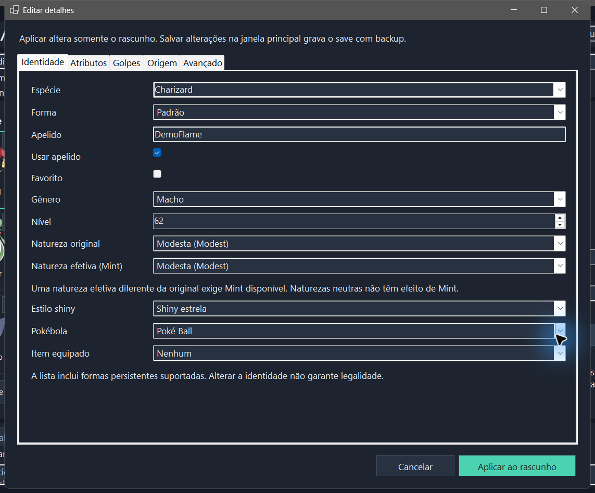

# Detailed Pokémon editing

Use **Edit details** on the selected party or box Pokémon. The detailed editor returns changes to the main window's draft; **Save changes** writes them with a backup. Cancelling the dialog leaves the existing draft intact. The **+** flow uses the same supported customisation fields when creating a Pokémon.

## Field groups

| Group | Purpose |
| --- | --- |
| Identity | Species, persistent form, nickname, gender, level, non-shiny/star/square shiny appearance, original/effective Mint nature, ball, held item and favourite |
| Attributes | IVs, EVs, Hyper Training, friendship and six coloured organisation markings |
| Moves | Four move slots and species-compatible Plus move flags; PP and relearn history are inspected according to Z-A limits |
| Origin | Original trainer/name/gender, raw TID16/SID16, language, encounter level/location/date and obedience level |
| Advanced | Supported size/Alpha data and an existing affixed ribbon/title; technical identifiers and the original PKHeX report are shown for inspection |

When adding, tick an optional field to override its automatic value; leave it unticked to keep generation automatic. Species, form, level, original nature, shiny style and ball are directly selectable.

Changing a species or form does not regenerate an existing Pokémon. Unchanged data is preserved; dependent values must still be compatible with the selected species/form. The editor validates field ranges and storage structure, then reports PKHeX legality findings. It does not invent a legitimate encounter for every combination.

## Safe workflow

1. Close ZA Recomp and load the intended `main` file.
2. Select a Pokémon and open its details. Review the original values before editing.
3. Apply the detail changes to the draft. You can still adjust the quick controls, review another Pokémon, or discard drafts.
4. Save explicitly. If the file changed externally, reopen it instead of overwriting the newer save.
5. Keep the automatic backup until you have checked the result in the game.

IV/EV order in the interface is labelled by stat. An IV is 0–31; each EV is 0–252 and the total cannot exceed 510. Hyper Training is a separate flag and does not replace the stored IV. Original nature and effective Mint nature are separate values.

## Z-A-specific limits

- Held items are meaningful, including Mega Stones. The editor offers persistent forms rather than storing a temporary battle form in a box.
- PP and PP Ups do not provide the usual battle mechanic in Z-A. Stored values are shown/calculated rather than offered as an unlimited-PP feature.
- Stored relearn data is history metadata, not the list of moves you can relearn through the game's interface.
- Alpha status is not a cosmetic checkbox alone: encounter, size, IVs and Plus moves can affect legality. A custom edit can still produce a PKHeX warning.
- Ability data, origin game, HOME tracker, egg history and handler metadata are preserved or inspected rather than fabricated. No egg-creation or game-conversion workflow is provided.
- An affixed title refers to a ribbon/mark already present on the Pokémon; it does not award arbitrary event ribbons.

Raw TID16/SID16 are the two stored 16-bit values, not the six-digit trainer number displayed by modern games. The displayed IDs and technical identifiers are available for inspection. Size controls use stored scalar values (0–255), not metres or kilograms.

Some PA9 fields belong to compatibility/history data or have no supported editing workflow in Z-A. A field existing in the binary is not proof that changing it has a meaningful in-game effect. Read-only metadata is shown as such; this tool is not a raw hex editor and does not convert Pokémon from other games or manufacture eggs.

## Português

Abra **Editar detalhes** no Pokémon da equipe ou box. Aplicar devolve as mudanças ao rascunho; **Salvar alterações** grava com backup. Cancelar preserva o rascunho anterior. O botão **+** oferece os mesmos grupos de personalização compatíveis. Natureza original, efeito de Mint, IVs e Hyper Training são campos distintos. A validação estrutural não garante encontro legítimo nem aceitação online.

## Español

Abre **Editar detalles** en el Pokémon del equipo o caja. Aplicar devuelve los cambios al borrador; **Guardar cambios** escribe con copia de seguridad. Cancelar conserva el borrador anterior. El botón **+** ofrece los mismos grupos de personalización compatibles. Naturaleza original, efecto de Mint, IVs e Hyper Training son campos distintos. La validación estructural no garantiza un encuentro legítimo ni aceptación online.
