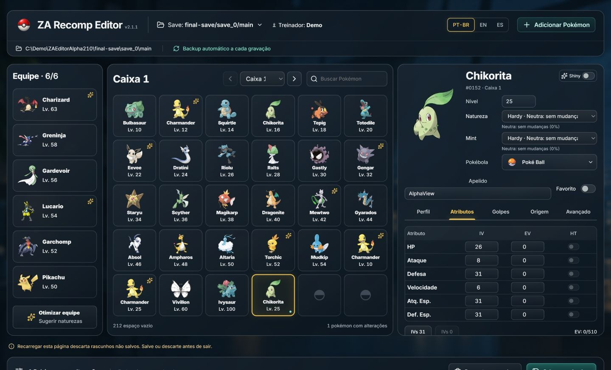

# Alpha inspector identity regression — 2.1.1

## Reproduction and cause

On the shipped 2.1.0 EXE, open the synthetic Chikorita level 25, select Custom Alpha and apply the plan without saving. The inspector heading becomes `#0` and artwork falls back to `#0000`. The save remains unchanged. The real response retains species 152 in `preview.values` but serializes `patch.species:null` and 29 other nullable patch members.

`PokemonPatch` defines null as preserve. The browser spread the entire patch into the current draft, masking species, form, nickname and other baseline values with null. The sprite resolver therefore received species 0. The failure occurs before artwork retrieval; it is not a missing Alpha-specific image.

## Correction

Filter null/undefined only at the incoming Alpha-plan boundary. Keep explicit zero, false, empty string and empty array edits. Merge actual plan changes into existing drafts; creation's existing automatic null choices stay automatic. Undo tracks only the fields actually supplied by the plan. The Engine/API null-preserves contract and save format are unchanged.

A sanitized fixture extracted from the actual response (patch only) now drives the regression harness, including the real apply/update path, existing nickname/level/ball drafts, creation and Undo. Earlier checks used sparse patches and persistence/reopen assertions, missing the intermediate Apply-before-Save presentation state.

## Evidence

- Before: reproduced on the 2.1.0 EXE using a synthetic save; heading `#0` after Apply.
- Focused client regressions: 49 passed, including ten new checks; the real-payload case failed before the fix.
- Independent focused source review passed. Root browser QA confirmed the image loaded (475px source width), Chikorita/species 152 and prior nickname draft survived Apply in both modes; Undo retained the nickname. Desktop and 390px inspected, narrow document width 375px within the 390px viewport. The synthetic save SHA-256 stayed unchanged. Portable/publication evidence is recorded with the final 2.1.1 release.

No personal save was used for write tests. This presentation correction does not change Alpha legality rules or imply game/online acceptance.

