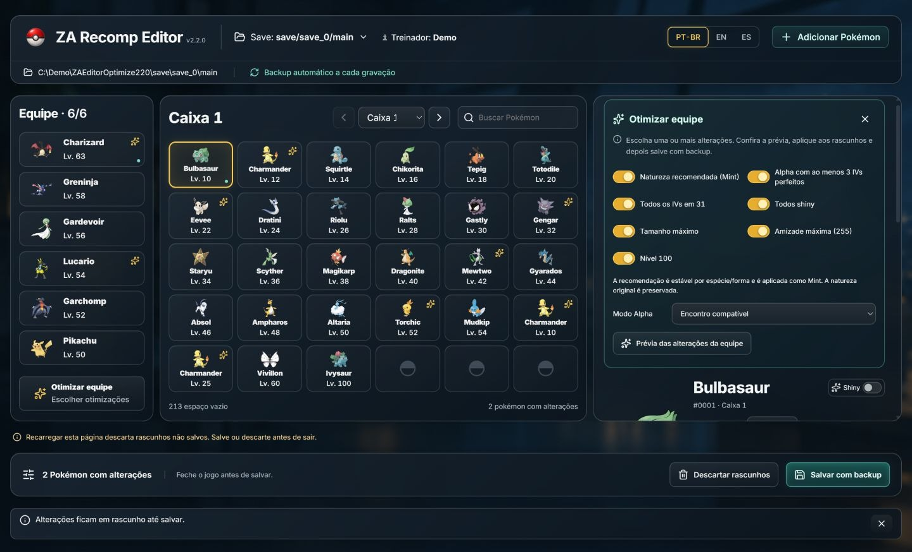
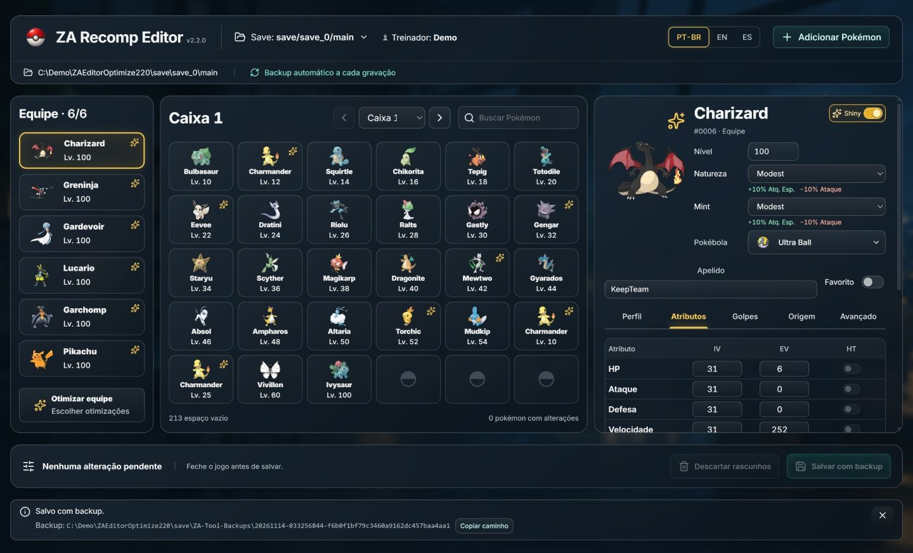

# Team Optimize — 2.2.0 delivery contract

Preserve the accepted single-page acrylic workspace. No modal or new navigation surface. The inspector opens an inline selection panel with seven independent choices: stable recommended effective nature (Mint), Alpha, all IVs 31, shiny, maximum size, maximum friendship, level 100. No option writes a save directly.

1. Tracer: one non-writing, hash-coherent team plan crosses UI → host → Engine → per-Pokémon preview/diff → explicit draft Apply. Verify no change to input bytes, existing party/box drafts retained, stale/cancel handling and repeatable nature recommendations.
2. Extend the same planner to selected combinations. Alpha invokes the existing compatible/custom policy explicitly; unavailable members block applying the entire batch. Preserve origin/identity where the accepted Alpha contract permits. Alpha IV selection raises useful natural IVs without lowering existing IVs; all-IVs is a separate explicit option. Max size follows native/HOME rules, IV presets clear conflicting HT, existing square shiny stays square, friendship is 255 and level is 100 only when selected.
3. Validate draft application and one normal backed-up batch save/reopen on synthetic data. Check all selected effects, preservation of unselected fields/slots, repeated-plan idempotence, invalid member rejection, desktop/390px and original/duplicate nature-effect presentation. Package only after source and visual acceptance.

State: panel options and server plan are transient browser state. Existing Engine expected hash, validation, whole-folder backup and explicit SaveEdits remain the only write path. Apply replaces each covered party draft with its complete canonical sparse patch relative to disk; an empty patch removes an earlier draft reverted to its stored value. Every covered slot must occur exactly once, including empty patches. Box drafts remain unchanged. Change selection/options/drafts/session/hash invalidates the plan. Planning errors remain inline and never cause a partial apply.

The nature recommendation is a transparent stable species/form starting profile rather than a universal competitive guarantee. It must not depend on current nature, trained stats, current moves, level, locale, or previously applied optimization. Apply its effect via Mint; keep original nature and identity. Reasons state the stable basis.

Affected ownership: backend owns Engine/host contracts and OptimizeTests; frontend owns WebClient; root owns integration wiring/version, documentation, CUA and packaging; verifier is read-only. Endpoints and result details are documented from the final producer contract, not guessed by consumers.

## Executed acceptance

- 71 client regressions and TypeScript/Vite passed. Engine/API: 45 Optimize + 61 Alpha + 44 HTTP; 52 legacy Engine checks passed. Independent source review found no remaining blocker.
- Root browser QA used a disposable six-member synthetic team plus one box draft. All seven options in Compatible mode produced six available previews. Save hash stayed unchanged after Preview and Apply. One explicit backed-up Save persisted level 100, Alpha, six IVs 31, shiny, Scale 255, friendship 255 and recommended effective natures. Original nature, EVs, encryption constants and party/box nickname drafts were preserved. Backup main matched the exact original SHA-256.
- Repeating the seven options after save reported six members and zero proposed changes; applying that no-op left Save disabled. Recommendation IDs did not oscillate.
- Desktop 1440×874 and 390px UI inspected. Narrow document width 375px fit the viewport; seven checkbox labels were 44px high. The narrow Apply action was 307×44, visible and not covered by the fixed footer, and clicking Preview/Apply succeeded. Focus returned to Optimize. Reduced-motion preference was true; no intermediate animation frame was captured. Anime.js scopes and cleanup remain in source.
- PT-BR, English and Spanish controls were exercised. Explanation text is generated in the preview request's locale; an existing preview keeps its generated wording until regenerated. English regeneration returned English reasons without different recommendations. Original English nature/move names and upstream report remain unchanged.
- No personal save or actual game was written/launched. Not verified: every species/form, real phone/screen-reader hardware, game/online acceptance, power-loss or an uncooperative writer race. Portable/remote-CI evidence is recorded in the release.

[Narrow preview/action capture](../screenshots/web/team-optimize-narrow-2.2.0.jpg)
